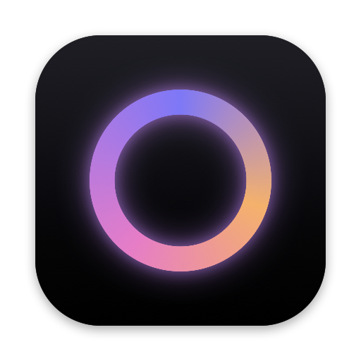
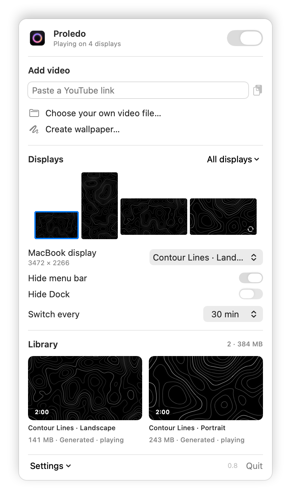
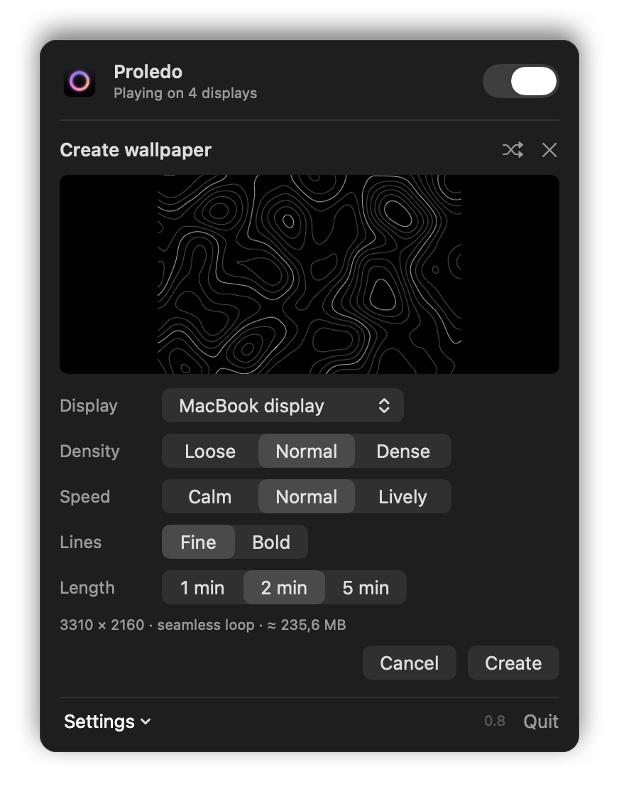
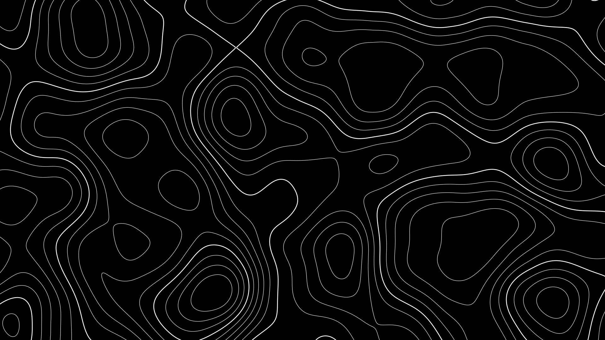
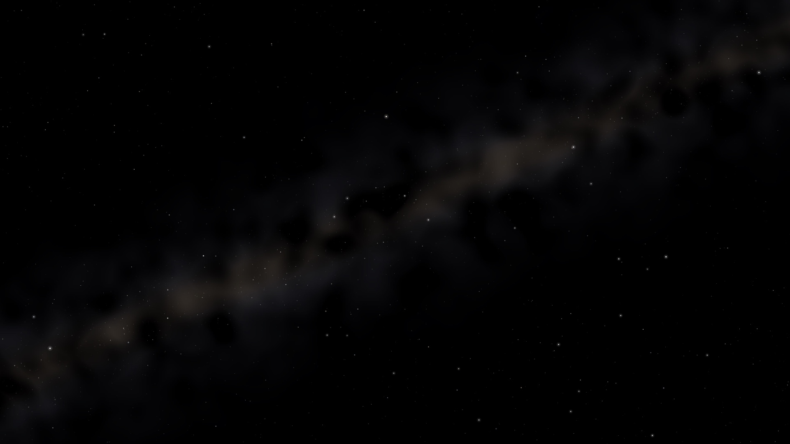
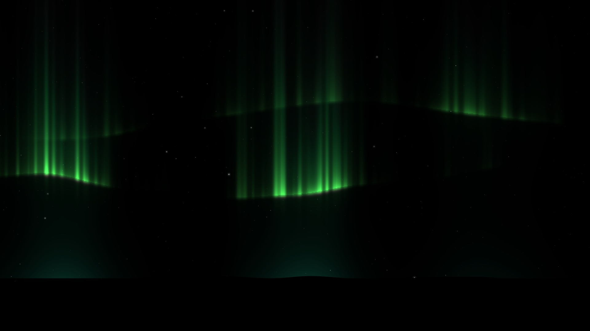
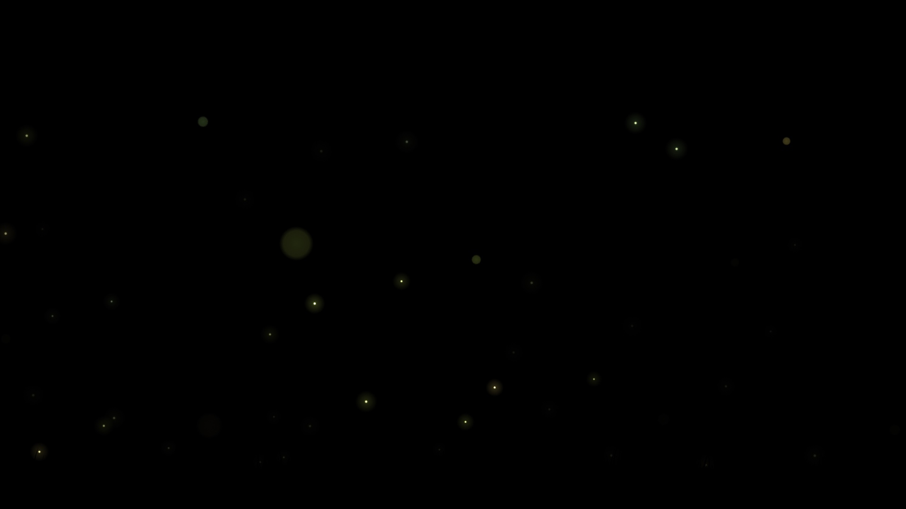
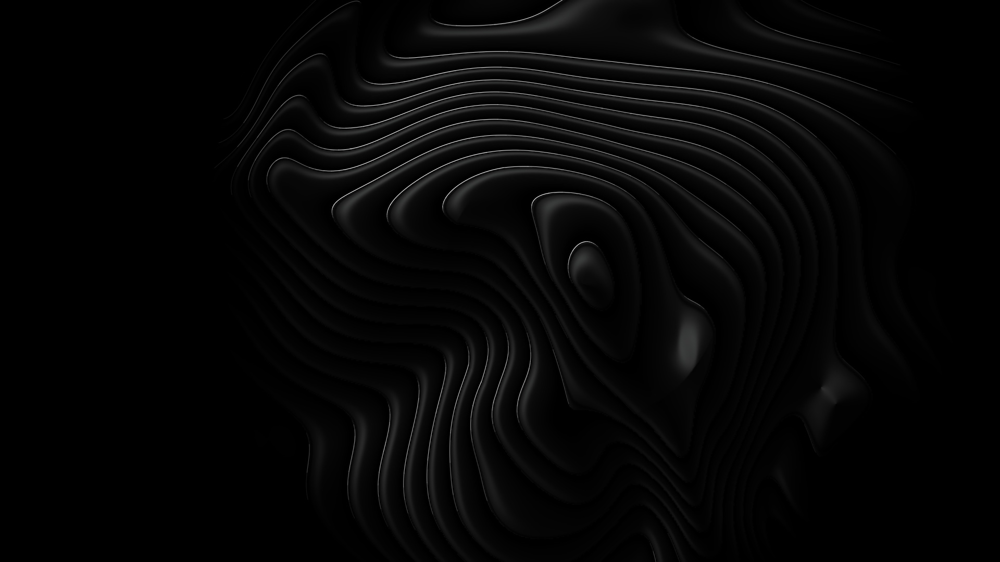

<p align="center">
  
</p>

<h1 align="center">Proledo</h1>

<p align="center">
  Moving wallpapers for Macs with a PROLED or OLED display, so nothing burns in.<br>
  <a href="https://github.com/Pixzl/Proledo/releases/latest"><b>Download the latest release</b></a>
</p>

<p align="center">
  <picture>
    <source media="(prefers-color-scheme: dark)" srcset="docs/menu-dark-0.8.png">
    
  </picture>
  
</p>

Made for the MacBook Pro with PROLED XDR display, works on any Mac and any external monitor. Proledo lives in your menu bar. Paste a YouTube link, the video gets saved locally and plays as your desktop background. Every monitor can have its own video, or none at all.

## What it does

- Downloads YouTube videos without sound, in the quality you pick
- Grabs just a slice of long videos, like 10 minutes out of a 12-hour one
- Lets you choose a video per monitor, portrait screens included, or rotate through all of them
- Hides the menu bar and Dock per monitor, they come back when your mouse hits the edge
- Pauses on its own when the desktop is covered, the Mac is locked or running on battery
- Has a power saving mode that plays a lighter 30 fps copy of each video
- Never keeps your screen awake
- Works with your own video files too
- Creates its own wallpapers as seamless loops sized for each display: contour lines, starry sky, northern lights, fireflies or silk
- Available in English, German, French and Spanish

## Make your own

Proledo can draw wallpapers for you, sized for the exact display you pick. They loop without a visible jump and have no watermark, so nothing on screen stays still.

**Contour lines:** white lines slowly flowing over black.

<p align="center">
  
</p>

**Starry sky:** stars drifting in three layers, a faint Milky Way you can switch off, and now and then a shooting star.

<p align="center">
  
</p>

**Northern lights:** curtains of light with fine rays swaying over a dark horizon, with stars shining through.

<p align="center">
  
</p>

**Fireflies:** little lights drifting over a meadow and flashing up one by one. The lightest on your screen of all styles.

<p align="center">
  
</p>

**Silk:** dark satin layers slowly folding and drifting across the screen, with a soft sheen and bright edges.

<p align="center">
  
</p>

## Install

Grab `Proledo.zip` from the [latest release](https://github.com/Pixzl/Proledo/releases/latest), unzip it and move Proledo to your Applications folder.

The app isn't notarized yet, so macOS blocks it on first launch. Right-click it and choose **Open**, or run:

```bash
xattr -dr com.apple.quarantine /Applications/Proledo.app
```

## Requirements

- macOS 14 or later
- [yt-dlp](https://github.com/yt-dlp/yt-dlp) for YouTube downloads
- [ffmpeg](https://ffmpeg.org) for clips

```bash
brew install yt-dlp ffmpeg
```

## Build

```bash
./build.sh
open build/Proledo.app
```

To redraw the icon, run `swift Tools/make-icon.swift <folder>.iconset` and turn it into `Resources/Proledo.icns` with `iconutil`.

## Note

Only download videos you're allowed to use. YouTube's terms of service restrict downloads.

## License

Proledo is released under the [MIT License](LICENSE). yt-dlp and ffmpeg aren't part of Proledo, you install them yourself and they come with their own licenses.
